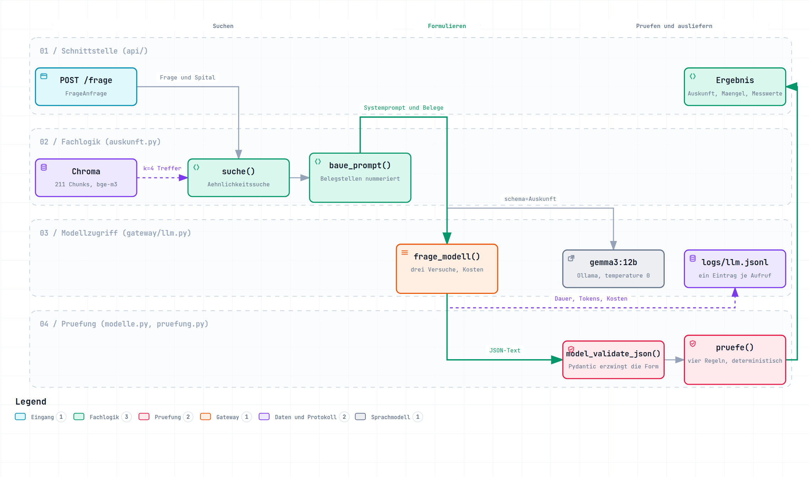
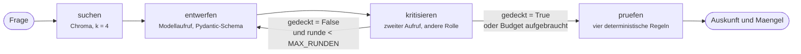

# hr-policy-assistant

A retrieval system over public Swiss collective labour agreements that answers
questions with citations down to section number and page. The corpus is German,
so the rest of this README is German as well.

RAG-System über öffentliche Schweizer Gesamtarbeitsverträge, das Fragen mit
nachprüfbaren Quellenzitaten beantwortet. Der Korpus umfasst heute zwei GAV,
weitere HR-Dokumente wie Personalreglemente sind vorgesehen.

> AI-Engineering-Sprint 24.08.–18.10.2026. Was läuft, was bewusst nicht gebaut
> wurde und welche Grenzen gemessen sind, steht unter «Stand».

## Warum dieses Projekt

Wer wissen will, wie lang seine Kündigungsfrist in der Probezeit ist, sucht die
Antwort in einem PDF, das kaum jemand liest. Ein Sprachmodell allein beantwortet
solche Fragen flüssig und manchmal falsch, weil es plausibel klingende
Regelungen erfindet. Eine reine Ähnlichkeitssuche findet Stellen, die dem
Wortlaut der Frage ähneln, aber nicht zwingend die, die auf den Fall anwendbar
sind. Deshalb Retrieval mit Quellenangabe und Metadaten, damit jede Aussage auf
Ziffer, Seite und Dokument zurückführbar bleibt und eine veraltete Fassung als
solche erkennbar ist.

## Stand

### Läuft heute

- ETL-Strecke beider GAV vom PDF bis in den Vektorstore
- Textbereinigung, Schnitt an Gliederungsziffern, Hierarchiepfad und Seitenzahl pro Abschnitt
- Tabellen werden zeilenweise in Satzform gelesen, jeder Wert trägt seine Spaltenbezeichnung
- Einbettung lokal über Ollama mit `bge-m3`
- Chroma-Sammlung `hr_policy` mit Kosinus-Abstand, 211 Chunks. Das Embedding-Modell steht als
  Metadatum an der Sammlung, damit beim Lesen nachvollziehbar ist, womit eingebettet wurde.
  Eine Prüfung beim Öffnen gibt es heute nicht, sie wäre die natürliche Ergänzung
- Metadaten an jedem Chunk, darunter Dokument, Ziffer, Seite, Titel, Pfad, Stand und Aktualitätsstatus
- LLM-Gateway für alle Ollama-Aufrufe, Chat und Embedding. Jeder Aufruf wird als JSON-Zeile
  protokolliert, bei Verbindungsfehlern in insgesamt bis zu drei Versuchen mit wachsender Pause
  wiederholt und mit Tokenzahlen, Dauer und Kosten zurückgegeben
- End-to-End-Antwort mit Belegnummern über ein lokales Sprachmodell, Standard `qwen2.5:14b`
- Strukturierte Ausgabe. Das Schema aus den Pydantic-Klassen geht als `format` an Ollama, die
  Rückgabe wird mit `model_validate_json` geprüft. Pro Haus ein Eintrag mit Aussage und
  Belegstellennummern
- Deterministische Strukturprüfung jeder Antwort gegen die Metadaten der Treffer, vier Regeln
  mit sechs Mängelmeldungen. Ob eine Aussage inhaltlich gedeckt ist, prüft sie nicht
- Workflow über LangGraph mit vier Knoten und einem bedingten Rücksprung. Ein Kritik-Knoten
  liest jeden Entwurf gegen die Belegstellen und gibt strukturiert zurück, welche Aussage nicht
  gedeckt ist. Bei Beanstandung geht der Graph einmal zurück zum Entwurf
- HTTP-Schnittstelle mit FastAPI. `POST /frage` gibt Auskunft, Mängel und Messwerte zurück,
  `GET /gesund` ist ein Lebenszeichen. Die Schnittstellenbeschreibung nach OpenAPI und die
  Oberfläche unter `/docs` entstehen aus denselben Pydantic-Klassen
- Eval-Set mit 20 Fällen, zu jedem eine vor dem Lauf festgelegte Sollantwort je Haus.
  Der Runner misst Retrieval, `frage_beantwortet`, Pflicht- und Verbotsbegriffe, Strukturmängel,
  p50 und p95, Tokens und Kosten und schreibt eine CSV je Lauf
- Zweiter Weg über LangGraph mit Kritik-Rolle, vier Knoten und einem bedingten Rücksprung.
  Jeder Kritik-Aufruf sieht genau ein Haus und nur dessen Belegstellen
- Dritter Weg als Agent-Loop. Dasselbe Ziel, aber das Modell wählt aus drei Werkzeugen selbst,
  mit einer Notbremse bei acht Runden. Gebaut als Vergleich zum Graphen, nicht als Ersatz
- Bedienoberfläche unter `GET /`, ausgeliefert von derselben Anwendung. Die drei Wege sind
  darin wählbar, und der Verlauf eines Laufs ist sichtbar
- Docker-Image mit Anwendung und Index, auf Docker Hub unter
  `ksrigganthan/hr-policy-assistant`. Dazu eine `docker-compose.yml`, die Ollama als zweiten
  Dienst mitbringt, siehe «Betrieb mit Docker»
- Tests für Loader und Textbereinigung, Linting mit ruff

### Bewusst nicht gebaut

Entscheide, keine Lücken. Jeder Punkt war möglich und ist aus einem Grund unterblieben.

- **Vergleich gegen ein Cloud-Modell.** Der Aufbau trägt ihn, `gateway/llm.py` ist dafür
  modellagnostisch und die Preistabelle rechnet in Franken. Gemessen wurde er nicht, weil das
  Projekt den On-Premise-Fall zeigen soll und eine zugekaufte Zahl den Punkt nicht stärkt
- **Dreistufige Bewertung im Kritiker** statt gedeckt oder nicht gedeckt. Eine Stufe ist nur
  sinnvoll, wenn eine eigene Handlung an ihr hängt, und der Graph kennt zwei Fortsetzungen,
  zurück zum Entwurf oder weiter zur Prüfung
- **Multi-Agent-System mit acht bis neun Rollen.** Jeder weitere Agent kostet Zeit, Geld und eine
  Fehlerquelle. Der Nachweis lautet nicht «neun Agenten gebaut», sondern was ein Schritt an
  welcher Kennzahl bewirkt. Die Messung Graph gegen Agent-Loop zeigt, in welche Richtung das geht
- **Vetorecht für den Kritiker.** Siehe «Was der Kritiker nicht kann». Mit Vetorecht hätte der
  Lauf vom 15.09. vier richtige Antworten verworfen
- **Chroma als eigener Serverdienst** statt eingebettet. Es gibt ein Image dafür, und der Umbau
  wäre eine Zeile, `PersistentClient` würde zu `HttpClient`. Dagegen sprechen zwei Dinge. Es
  widerspricht dem Entscheid, Chroma gerade wegen des fehlenden Betriebsaufwands zu wählen. Und
  es löst das eigentliche Problem nicht, denn der Index muss trotzdem erst in das Volume des
  Servers hinein
- **Automatisches Ausrollen, also der CD-Teil einer Pipeline.** Siehe «Ausrollen, der Entwurf».
  Die Hardwareanforderung ist der Grund, nicht der Aufwand

### Gemessene Grenzen

- **Anhänge ohne Gliederungsziffer.** Die Lohntabelle auf Seite 24 des USB-GAV liegt im Index
  unter einem Abschnitt über Verbandskosten, weil «Anhang 3: Lohntabelle» keine Ziffer trägt und
  deshalb keinen neuen Abschnitt auslöst. Der Chunk ist über die Vektorsuche nicht auffindbar
- **Vokabular-Lücke im Retrieval.** Siehe «Wenn das Stichwort im Dokument fehlt». Eine Frage, die
  kein Wort des richtigen Abschnitts trifft, findet ihn nicht, und die Antwort ist dann falsch,
  ohne dass eine Prüfung anschlägt
- **Rauschband der Kennzahlen.** Das Modell antwortet auch bei temperature 0 nicht in jedem Lauf
  gleich. Wie stark die Zahlen ohne jede Änderung schwanken, ist nicht gemessen. Deshalb gilt in
  diesem README ein Unterschied von einer Einheit in 40 nicht als Ergebnis. Beobachtet wurde das
  am 16.09. auf `gemma3:12b`. Ob `qwen2.5:14b` sich gleich verhält, ist ebenfalls nicht gemessen,
  und es gibt keinen Grund anzunehmen, dass es besser ist
- **Aktualitätsprüfung.** Beide Fassungen sind von 2015 und 2016, das Metadatenfeld `status`
  steht auf `unbekannt`. Die Daten dafür liegen an jedem Chunk, die Regel fehlt
- **Tests für die Prüfregeln und für die Schnittstelle.** Loader und Textbereinigung sind
  getestet, `pruefung.py` und die Endpunkte nicht

### Fehlt noch

- Ein verlässlicher Kritiker. Der Knoten steht, hat die bekannte Halluzination gefangen und ist
  seit dem 18.09. und dem 15.10. zweimal nachgebessert worden. Seine Trefferquote liegt trotzdem
  bei rund einem Fünftel, siehe «Was der Kritiker nicht kann»
- GitHub-Actions-CI mit Test- und Eval-Gate

### Prüfskripte im Wurzelverzeichnis

Zwei Sorten. Die erste prüft im Betrieb von Hand nach und steht in `.gitignore`.

- `frage.py` stellt fünf feste Testfragen an den Index und zeigt zu jedem Treffer Abstand, Dokument, Seite, Ziffer, Titel und Textanfang
- `antworte.py` stellt dieselben fünf Fragen End-to-End über `auskunft.antworte` und druckt Auskunft, Mängel und Messwerte
- `zeige_index.py` zeigt, was in der Chroma-Sammlung steht, inklusive Metadatenfilter
- `messung.py` misst pro Dokument die Anzahl Abschnitte und die Längenverteilung
- `test_embed.py` und `test_llm.py` prüfen die Ollama-Verbindung für Embedding und Sprachmodell
- `kosten.py` liest das Protokoll und zeigt pro Aufruf Tokens, Dauer und Kosten sowie die Summen
- `teste_graph.py` schickt den Chefärzte-Fall einmal durch den Graphen und druckt den Verlauf
  jeder Runde, also den Abnahmetest von Hand

Die zweite Sorte gehört zu einer bestimmten Messung und liegt deshalb im Repository. Sie belegt,
wie eine Aussage in diesem README zustande gekommen ist.

- `zeige_ablauf.py` lässt einen Lauf über `GRAPH.stream()` laufen und zeigt je Knoten, welche
  Felder er geändert hat. Mit `--bild` gibt es das Mermaid-Diagramm aus dem kompilierten Graphen
- `kritik_ab.py` legt dem Kritiker vier Fehlalarm-Sätze einzeln vor, mit zwei Prompt-Fassungen.
  Hat gezeigt, dass der Prompt nicht die Ursache war, 0 von 4 mit und ohne geänderte Zahlenregel
- `kritik_ablation.py` erzeugt echte Entwürfe und legt sie dem Kritiker in vier Formen vor, zwei
  Faktoren mal zwei. Das ist die Messung, die die Ursache gefunden hat
- `lauf_graph_qwen.py` fährt denselben Graphen und dasselbe Eval-Set auf `qwen2.5:14b`. Nötig,
  weil der Agent-Loop Tool-Calling braucht und `gemma3:12b` das nicht kann. Ohne diesen Lauf
  würde der Vergleich zwei Modelle messen statt zwei Steuerungen
- `rauchtest_agent.py` schickt einen einzigen Fall durch den Agent-Loop, bevor das ganze Set läuft
- `zaehle_agentlauf.py` liest `logs/llm.jsonl` und zählt, wie viele Aufrufe eines Agentenlaufs
  Steuerungsaufrufe mit Werkzeugwahl waren

## Architektur

1. `lade_pdf` in `ingestion/loader.py` liest den Text je Seite mit Seitenzahl und überspringt die im Korpus vermerkten Verzeichnisseiten. `seite_als_text` liest eine Seite mit Tabellen in Bändern, also Text oberhalb, Tabelle in Satzform, Text unterhalb
2. `bereinige_seiten` normalisiert die Zeichen und entfernt Symbolzeichen
3. `finde_wiederholte_zeilen` und `entferne_wiederholte_zeilen` werfen Kopf- und Fusszeilen weg
4. `schneide_in_abschnitte` schneidet an nummerierten Überschriften und merkt sich die Startseite, `setze_pfade` trägt den Pfad der übergeordneten Titel ein
5. `lese_abschnitte` in `ingestion/index.py` führt das pro Korpusdokument zusammen
6. `einbetten` schickt die Texte in Stapeln von 32 an `embed` im Gateway
7. `baue_index` legt die Chroma-Sammlung neu an und schreibt Vektoren, Zitattext und Metadaten
8. `embed` in `gateway/llm.py` bettet die Frage ein, `frage_modell` ruft das Sprachmodell. Beide laufen durch
   `_mit_wiederholung`, das bei Verbindungsfehlern insgesamt bis zu drei Versuche unternimmt, mit Pausen von 1 und 2 Sekunden zwischen den Versuchen
9. Die Antwort entsteht aus Frage, den vier nächsten Chunks als nummerierte Belegstellen und einer Systemnachricht mit Regeln
10. `protokolliere` schreibt Zeit, Modell, Tokens, Dauer, Versuchsnummer, Kosten und Frage als eine Zeile nach `logs/llm.jsonl`
11. `antworte` in `auskunft.py` gibt das Schema aus `modelle.py` an das Gateway weiter und prüft die Rückgabe mit `model_validate_json`
12. `pruefe` in `pruefung.py` vergleicht die Auskunft mit den Metadaten der Treffer und gibt eine Liste von Mängeln zurück
13. `stelle_frage` in `api/main.py` setzt Auskunft, Mängel und Messwerte zu einem `Ergebnis` zusammen und gibt es als JSON zurück
14. `antworte_mit_kritik` in `workflow/graph.py` ist der zweite Weg zu einer Antwort. Er führt dieselben Schritte in vier Knoten aus und schiebt zwischen Entwurf und Prüfung eine Kritik ein
15. `antworte_mit_agent` in `workflow/agent.py` ist der dritte Weg. Die Schritte sind dieselben, aber sie liegen als Werkzeuge bereit, und das Modell wählt bei jedem Durchgang selbst, welches es ruft
16. `oberflaeche` in `api/routen/oberflaeche.py` liefert unter `GET /` eine HTML-Seite aus, die ihrerseits `POST /frage` aufruft. Ein Ursprung, ein Prozess, kein CORS

### Ablauf einer Anfrage

<picture>
  <source media="(prefers-color-scheme: dark)" srcset="docs/bilder/ablauf-anfrage-dunkel.png">
  
</picture>

Die vier Bahnen sind die vier Schichten aus dem Abschnitt oben. Die Richtung der Pfeile ist
zugleich die Abhängigkeitsrichtung im Code. `pruefung.py` kennt weder die API noch das Gateway,
es bekommt eine `Auskunft` und die Treffer und gibt eine Liste von Mängeln zurück.

Das Bild zeigt den einstufigen Weg. Graph und Agent-Loop setzen auf denselben Bausteinen auf und
unterscheiden sich nur darin, in welcher Reihenfolge sie diese aufrufen. Deshalb kostete der
dritte Weg eine Datei und kein zweites System.

**[Interaktive Fassung öffnen](https://ksriganthan.github.io/hr-policy-assistant/ablauf-anfrage.html)**
mit Zoom, Suche, Fokus auf einen Knoten und Verfolgung der Beziehungen. Sie liegt als
[`docs/ablauf-anfrage.html`](docs/ablauf-anfrage.html) im Repo, die Quelle dazu als
[`docs/diagramme/ablauf-anfrage.workflow.json`](docs/diagramme/ablauf-anfrage.workflow.json).
Gerendert mit [archify](https://github.com/tt-a1i/archify).

## Ingestion

Die Ingestion ist eine ETL-Strecke. **Extract** liest den Text je Seite aus dem PDF.
**Transform** normalisiert die Zeichen, entfernt Symbolzeichen sowie Kopf- und Fusszeilen,
schneidet an Gliederungsziffern und trägt Pfad und Seitenzahl ein. **Load** schreibt Vektoren,
Zitattext und Metadaten in die Chroma-Sammlung. Transformiert wird vor dem Laden und nicht danach,
weil der Vektorstore keine Transformationssprache hat und der Chunk beim Schreiben bereits die
Einheit sein muss, die später zitiert wird. Der grösste Teil der Arbeit steckt im Transform-Schritt,
und zwar nicht im Umformen, sondern im Finden der Fälle, die still danebengehen.

Beide PDF-Dateien sind für Menschen gesetzt und nicht für Maschinen, und jedes bricht
auf eigene Art.

**Zeichen normalisieren.** Im USB-PDF stehen die Umlaute zerlegt, also als
Grundbuchstabe plus kombinierendes Trema. Eine Suche nach «Kündigungsfrist»
findet im Rohtext null Treffer, obwohl das Wort achtmal im Dokument steht. Nach
der Normalisierung nach NFC sind es acht. Der Fehler ist unsichtbar, weil der
Text auf dem Bildschirm richtig aussieht.

**Symbolzeichen entfernen.** Dasselbe PDF enthält 43 Zeichen aus dem
Private-Use-Bereich, alle U+F0B7, ein Aufzählungspunkt aus Wingdings. Der Loader
verwirft alles der Unicode-Kategorie Co. Das KSBL-PDF hat beide Probleme nicht,
an einem einzelnen Dokument wären sie also gar nicht aufgefallen.

**Kopf- und Fusszeilen entfernen.** Statt fester Muster zählt der Loader, auf
wie vielen Seiten eine Zeile vorkommt, und ersetzt dafür zuvor jede Ziffernfolge durch
ein Rautezeichen. Damit gelten «GAV 1 / 26» und «GAV 2 / 26» als dieselbe Zeile.
Was auf mindestens 80 Prozent der Seiten steht, fliegt raus. Gemessen liegen
Kopf- und Fusszeilen bei 95 bis 100 Prozent, die nächsthäufige Zeile bei 10 Prozent.

**Inhaltsverzeichnis.** Die Verzeichnisseiten werden nicht erkannt, sondern im
Korpuseintrag deklariert. Ein früherer Filter versuchte, sie an ihrer Form zu
erkennen, und warf dabei Tabellenzeilen wie «20 ½ 10» und Fussnoten aus dem
Regelungstext weg. Zwei Regressionstests halten diesen Fall fest. Welche Seiten
Verzeichnis sind, ist eine Eigenschaft des Dokuments und steht deshalb im
Korpus, nicht im Loader.

**Überschriften erkennen.** Ein Chunk ist keine feste Zeichenlänge, sondern ein
Abschnitt des Vertrags. Die Nummer am Zeilenanfang genügt zur Erkennung nicht.
«13. Monatslohn.» ist ein Begriff, «8.4 beziehungsweise 9.2 Stunden berechnet.
Für Teilzeit» ist ein Satz. `ist_ueberschrift` prüft deshalb zwei Signale
zugleich, das Nummernmuster und die Abwesenheit von Satzmerkmalen im Titel. So
findet der Loader beim KSBL 123 von 123 Verzeichnisnummern und beim USB alle 97
plus die tieferen Ebenen, die das Verzeichnis nicht auflistet.

**Tabellen.** `extract_text` gibt eine Tabelle als das aus, was optisch dasteht, also
«Dienstjahre In Monatslohn Oder in Tagen» und darunter «20 ½ 10». Welche Zahl zu welcher
Spalte gehört, ist danach nicht mehr entscheidbar, und beim Chunking kann die Kopfzeile
ganz wegfallen. Bei der Lohntabelle ist das der teuerste Fehlertyp des Systems, weil
Bandminimum und Bandmaximum ununterscheidbar werden. Tabellen laufen deshalb über
`extract_tables` und werden zeilenweise in Sätze umgeschrieben, «Dienstjahre 20, In
Monatslohn ½, Oder in Tagen 10». Ob die erste Zeile eine Kopfzeile ist, entscheidet die
Zellenlänge, weil ein PDF diese Auszeichnung nicht speichert. Gemessen haben echte
Kopfzeilen höchstens 13 Zeichen pro Zelle, die Urlaubstabelle auf Seite 10 hat 80, die
Schwelle liegt bei 30. Passen Kopfzeile und Datenzeile nicht in der Länge zusammen, wird
die reine Werteliste geschrieben, denn ein `zip` würde überzählige Werte still verwerfen.
Nichts verlieren geht vor sauber benennen. Gelesen wird die Seite in Bändern statt die
Tabellenzeilen anzuhängen, sonst stünde derselbe Inhalt zweimal im Text und beide Fassungen
konkurrierten im Retrieval um dieselbe Frage. Betroffen sind die drei Tabellen des
USB-GAV auf den Seiten 10, 11 und 24. Der KSBL-GAV hat keine.

Nicht behandelt sind Tabellen über einen Seitenumbruch. `extract_tables` sieht auf der
Folgeseite eine eigene Tabelle ohne Kopfzeile, dann greift der Rückfall auf die Werteliste.
Der Fall kommt im Korpus nicht vor und wäre ohne Testfall nicht prüfbar.

Eingebettet wird Pfad plus Abschnittstext, zitiert wird nur der Abschnittstext.
Der Pfad muss in die Einbettung, weil das Thema oft nur in der Überschrift
steht. Ziffer 2.3.3 des USB hängt unter «2.3 Beendigung des Arbeitsverhältnisses»,
und das Wort «Beendigung» kommt im Absatztext selbst nicht vor.

## Antwortgenerierung

Das Modell bekommt zwei Texte. Eine Systemnachricht mit Regeln, die aus den
Befunden der ersten Woche abgeleitet sind, etwa dass bei zwei zutreffenden
Dokumenten beide Regelungen mit Geltungsbereich zu nennen sind und dass eine
fehlende Regelung als solche zu benennen ist. Und eine Nutzernachricht mit den
vier nächsten Chunks als nummerierte Belegstellen, jede mit Dokument, Ziffer,
Titel, Seite und Stand in der Kopfzeile, gefolgt von der Frage.

Die Temperatur steht auf 0, damit dieselbe Frage dieselbe Antwort liefert und
sich Änderungen am Code von Zufall unterscheiden lassen.

**Erste Messung an den fünf Testfragen.** Vier von fünf inhaltlich richtig,
alle fünf mit Belegnummern, rund 1000 Prompt-Tokens und 14 bis 16 Sekunden pro
Antwort auf einer RTX 5070 Ti, damals mit `gemma3:12b`. Die Zahlen stammen aus Woche 1,
vor strukturierter Ausgabe und längerem Systemprompt, und sind nicht mit den Tabellen unter
«Resultate» vergleichbar. Zwei Befunde daraus.

Bei der Frage nach 20 Dienstjahren lag der richtige Chunk auf Platz 2, und die
Antwort war trotzdem falsch. Aus «10 Tage» wurde «CHF 10», weil die Tabelle im
Chunk als `20 ½ 10` ohne Spaltenzuordnung stand. Das Retrieval hat funktioniert,
die Generierung nicht. Belegt ist nicht richtig. **Behoben in der Ingestion**, siehe
«Tabellen». Seither lautet die Antwort «halber Monatslohn oder 10 Tage» mit Beleg auf
USB Ziff. 2.5.9.

Bei der Frage nach dem Vaterschaftsurlaub hat das Modell den Elternurlaub des
anderen Dokuments so dargestellt, als beantworte er die Frage. **Teilweise behoben.** Die
falsche Gleichsetzung ist weg, und die Dokumentzuordnung prüft seit der strukturierten
Ausgabe der Code. Ob das KSBL die Frage überhaupt beantwortet, bleibt eine inhaltliche Frage
und gehört ins Eval-Set.

**Fünf Prompt-Fassungen gegen diesen einen Fehler.** Ohne Regel gab das Modell den
Elternurlaub als Antwort aus. Mit der Regel «ein benachbartes Thema ist keine Antwort»
nannte es ihn korrekt als Elternurlaub, ohne das Fehlen zu melden. Mit der Anweisung,
das Fehlen zuerst zu melden, liess es beides weg. Mit einem Rollen- und Aufbaublock
(«nenne immer beide Häuser») wurden vier von fünf Fragen deutlich besser und die
Antwortzeit sank von 35 auf 20 Sekunden, aber der Elternurlaub füllte den KSBL-Platz
wieder ohne Vermerk. Ein längerer Aufbaublock mit nummerierten Entscheidungsschritten
machte es schlimmer und lieferte bei der Tabellenfrage «ein Monatslohn» statt «ein
halber». Behalten wurde die vierte Fassung.

Der Befund daraus. Eine Anweisung, die verlangt, eine Abwesenheit zu bemerken, ist die
schwerste Aufgabe für ein Sprachmodell, weil im Prompt nichts steht, was sie auslöst.
Und «nenne immer beide Häuser» steht im Widerspruch zu «nenne nur Passendes»; das Modell
bricht dann die weichere Regel. Die Information ist aber ausrechenbar. Nach der Suche ist
bekannt, aus welchen Dokumenten Treffer kamen, nach der Antwort, welche Belegstellen
verwendet wurden. Der Abgleich gehört deshalb in den Code und braucht die strukturierte
Ausgabe als Voraussetzung. Prompt-Regeln sind Bitten, Code ist eine Garantie.

## Gateway

Alle Aufrufe an Ollama gehen durch `gateway/llm.py`, beim Indexbau wie bei der
Abfrage. Das Embedding-Modell ist dort als einzige Konstante definiert, `index.py`
importiert sie. Drei Dinge passieren im Gateway für jeden Aufruf, ohne dass die
aufrufenden Module davon wissen.

**Protokoll.** Eine JSON-Zeile pro Modellaufruf in `logs/llm.jsonl`, angehängt, nie
überschrieben. Zeit, Modell, Tokens ein und aus, Dauer, Versuchsnummer, Kosten und die
Frage. Der Antworttext bleibt draussen, das Protokoll soll messen, nicht speichern.
`kosten.py` wertet es aus. Das ist die Datenbasis für die Eval-Tabelle.

**Wiederholung.** Bei Verbindungsfehlern bis zu drei Versuche, mit Pausen von 1 und
2 Sekunden zwischen den Versuchen. Gefangen werden nur Fehler, die von selbst wieder verschwinden können,
Ollama nicht erreichbar, Zeitüberschreitung, abgebrochene Verbindung. Ein falscher
Modellname wird nicht wiederholt, der geht beim dritten Mal genauso schief.

**Kosten.** Aus Tokenzahlen und einer Preistabelle je Modell, Eingabe und Ausgabe
getrennt, in CHF pro Million Tokens. Lokale Modelle stehen mit null drin. Für ein
Cloud-Modell wüchse nur die Tabelle, der Code bliebe gleich. Gemessen wurde das nicht,
siehe «Bewusst nicht gebaut».

**Ein Befund aus dem Test.** Ollama beendet, Skript gestartet, Ollama neu gestartet. Der
erste Lauf scheiterte, bevor die Wiederholung greifen konnte, weil das Embedding der
Frage noch direkt an Ollama ging und nicht durch das Gateway. Ein Tor nützt nur, wenn
niemand daran vorbeigeht. Seither laufen Abfrage und Indexbau durch dieselbe Schleife. Ausserdem
wirft die Ollama-Bibliothek bei fehlender Verbindung Pythons eingebauten
`ConnectionError`, nicht den `httpx.ConnectError`, den sie intern fängt. Ohne den Test
wäre beides erst im Betrieb aufgefallen.

## Strukturierte Ausgabe und Prüfung

Das Modell antwortet nicht mehr in Fliesstext, sondern in einer vorgegebenen Form.
`Auskunft.model_json_schema()` erzeugt aus den Pydantic-Klassen ein JSON-Schema, das als
`format` an `ollama.chat` geht. Ollama schränkt damit beim Erzeugen ein, welche Zeichen
zulässig sind, statt das Format im Prompt zu erbitten. Die Rückgabe wird anschliessend mit
`model_validate_json` ein zweites Mal geprüft, weil ein anderes Modell oder eine Cloud-API
sich anders verhalten kann.

Die Form hat zwei Ebenen. `SpitalAuskunft` hält das Feld `spital`, ob die Belegstellen die Frage
beantworten, die Aussage in ganzen Sätzen und die Nummern, auf denen sie beruht. `Auskunft`
hält die Liste dieser Einträge und einen optionalen Hinweis. Die Belegstellen hängen
bewusst am einzelnen Haus und nicht an der ganzen Antwort, sonst liesse sich nicht
prüfen, ob eine Aussage über das eine Haus auf einer Belegstelle des anderen beruht.

Mit den Formatregeln aus dem Systemprompt verschwanden auch die eckigen Klammern im
Antworttext. Eine übersehene Zeile, die noch ein umbenanntes Feld nannte, hat gezeigt, wie
teuer eine tote Referenz im Prompt ist. Sie war die Ursache von drei Fehlern in der Ausgabe
und verschwand mit einer einzigen Korrektur.

`pruefe` in `pruefung.py` vergleicht danach die Antwort mit dem, was geliefert wurde. Vier
Regeln, alle deterministisch und ohne Modellaufruf.

1. Genau ein Eintrag je Haus
2. Jede genannte Belegstellennummer existiert und stammt aus dem Dokument dieses Hauses
3. Wer die Frage beantwortet, nennt eine Belegstelle, wer sie nicht beantwortet, nennt keine
4. Im Antworttext stehen keine Belegstellennummern in eckigen Klammern

Die Zuordnung von Nummer zu Dokument kommt aus den Metadaten der Treffer, also aus derselben
Nummerierung, die der Prompt vergibt.

**Was die Prüfung nicht kann.** Sie prüft die Struktur einer Antwort, nicht ihre Wahrheit.
Ein Lauf mit null Mängeln enthielt die Aussage, Chefärzte gehörten zu den Führungs- und
Fachkadern und seien deshalb vom GAV ausgenommen. Die zitierte Ziffer nennt Chefärzte gar
nicht, sie nennt drei ausgenommene Gruppen und hält fest, dass die betroffenen Funktionen
anderswo benannt werden. Richtiges Dokument, richtige Nummer, alle vier Regeln grün, Aussage
nicht gedeckt. Deckung zu messen braucht ein Eval-Set mit Sollantworten, und sie im Betrieb
zu erkennen braucht eine zweite Instanz, die jede Aussage gegen ihre Belegstelle hält.

## Workflow mit Kritik-Rolle

Der zweite Weg zu einer Antwort, `workflow/graph.py`. Dieselben Schritte, aber als Zustandsautomat
mit vier Knoten und einer bedingten Kante.



Die Bedingungen an den beiden Kanten aus `kritisieren` sind `wie_weiter()` im Bild. Der Kritiker
hat kein Vetorecht, deshalb fuehrt die obere Kante auch dann nach `pruefen`, wenn Beanstandungen
offen sind und das Budget aufgebraucht ist.

Das Bild ist von Hand gepflegt. Zur Kontrolle gibt `uv run python zeige_ablauf.py --bild` den
Graphen als Mermaid aus, erzeugt aus dem kompilierten Objekt. Es ersetzt das Bild hier nicht,
weil es die Bedingungen an den Kanten nicht mitliefert, es beantwortet nur die Frage, ob Knoten
und Kanten noch stimmen. Ohne `--bild` zeigt dasselbe Skript einen Lauf Schritt fuer Schritt, je
Knoten mit den Feldern, die er geaendert hat.

`suchen` holt die vier Treffer. `entwerfen` erzeugt die `Auskunft` wie `antworte()`, hängt aber
die Beanstandungen der Vorrunde als Zusatzauftrag an den Prompt. `kritisieren` legt den Entwurf
neben die Belegstellen und gibt ein `Kritik`-Objekt zurück mit `gedeckt`, den beanstandeten
Sätzen im Wortlaut und einer Begründung. `pruefen` ruft `pruefe()` und beendet den Lauf.

**`kritisieren` macht einen Aufruf je Haus, und jeder sieht nur die Belegstellen seines Hauses.**
Das steht so seit zwei Korrekturen, die beide dieselbe Ursache hatten, und ist der Teil dieses
Systems, der am meisten über Fehlersuche sagt. Die Einzelheiten stehen unter «Was der Kritiker
nicht kann». Die Nummerierung der Belegstellen bleibt dabei die des ganzen Treffersatzes, dafür
nimmt `baue_prompt` die ursprünglichen Nummern entgegen. Würde je Haus neu ab eins gezählt,
zeigte `belegstellen: [3]` im Entwurf auf eine andere Stelle als `[3]` beim Kritiker.

Der Zustand ist ein `TypedDict` mit zehn Feldern, darunter `runde`, `verlauf` für das Mitlesen
und `aufrufe`, über das der Eval-Runner die Tokens mehrerer Modellaufrufe summiert. Knoten geben
keine fertigen Ergebnisse zurück, sondern Änderungsmeldungen, die LangGraph in den Zustand
einträgt.

**Der Kritiker hat kein Vetorecht.** Nach `MAX_RUNDEN` geht der Graph zu `pruefen`, und die
letzte Fassung zählt, auch wenn noch Beanstandungen offen sind. Das war zunächst eine
Vorsichtsmassnahme und hat sich als notwendig erwiesen.

### Was der Kritiker gebracht hat

Der Abnahmetest ist der Chefärzte-Fall. Vorher:

> Der GAV gilt für Chefärzte am Universitätsspital Basel nicht, da diese der Gruppe der Führungs-
> und Fachkader gemäss spitalspezifischer Regelung des Verwaltungsrats angehören.

Nachher, nach einem Rücksprung:

> Dem GAV sind nicht unterstellt: a. Mitglieder der Geschäfts- bzw. Spitalleitung, b. Führungs-
> und Fachkader gemäss spitalspezifischer Regelung des Verwaltungsrats (Funktionen werden
> betrieblich benannt.) und c. Personal in Ausbildung und Praktikanten. Chefärzte werden in den
> genannten Ausnahmen nicht explizit genannt.

Der Verlauf zeigt die Kette. Der erste Entwurf enthielt die Halluzination wörtlich, der Kritiker
beanstandete genau diesen Satz, der zweite Entwurf nennt die Kategorien ohne Zuordnung. Die
falsche Aussage ist durch eine belegte ersetzt und nicht durch ein Schweigen, und das war die
Anforderung: ein Vergleichslauf mit mehr Kontext hatte dieselbe Halluzination zwar entfernt,
aber nur, indem das Modell die Auskunft verweigerte.

### Was der Kritiker nicht kann

Von zwanzig Fällen lösten acht einen Rücksprung aus, vier davon enden mit `gedeckt = False`. **In
allen vier ist die beanstandete Aussage richtig**, drei davon sind fast wörtliche Zitate aus der
Belegstelle. Der klarste Fall ist die Abgangsentschädigung:

| | |
|---|---|
| Antwort | «Die Abgangsentschädigung beträgt maximal zwölf Monatslöhne.» |
| Kritiker | beanstandet genau diesen Satz |
| KSBL Ziff. 10.10 | «Die Abgangsentschädigung beträgt maximal zwölf Monatslöhne.» |

Drei Gegenproben: der Satz steht wörtlich im GAV, die Ziffer war unter den vier Treffern, und das
Eval-Set verlangt für dieses Haus genau diese Begriffe. Der Kritiker beanstandet, was laut der
vorab festgelegten Sollantwort dort stehen muss.

Drei der vier Fehlalarme betreffen Zahlen, Fristen oder Beträge. Genau diese Sorte nennt
`KRITIK_SYSTEM` als Fehlerart, und das einzige Negativbeispiel im Prompt ist ebenfalls ein
Betrag. Die naheliegende Erklärung ist, dass das Modell aus Regel und Beispiel eine Abkürzung
gelernt hat, also Beträge als verdächtige Sorte behandelt statt den Einzelfall zu prüfen. Das ist
nicht gemessen, sondern aus der Verteilung geschlossen. Die Messung dazu ist der erste Punkt der
nächsten Woche.

**Deshalb misst die Kennzahl «am Ende nicht gedeckt» in dieser Fassung Fehlalarme, nicht
ungedeckte Antworten.** Und deshalb ist es gut, dass der Kritiker nicht verwerfen darf. Mit
Vetorecht hätte dieser Lauf vier richtige Antworten weggeworfen.

#### Die Ursache, gefunden am 17.09. durch Ablation

Zwei naheliegende Erklärungen wurden geprüft und beide verworfen. Der Prompt war es nicht,
`kritik_ab.py` ergab 0 von 4 mit und ohne geänderte Zahlenregel. Die Belegstellen-Liste im
übergebenen Text war es auch nicht.

Gefunden hat sie `kritik_ablation.py`, zwei Faktoren mal zwei. Beide Häuser im übergebenen
Entwurf ergeben 3 bis 4 Fehlalarme von 4, ein Haus allein 1 von 4. **Der Kritiker prüfte eine
USB-Aussage gegen die Belegstellen beider Häuser, fand eine widersprechende Zahl und las den
Widerspruch als fehlende Deckung.** Bei Fall 18 beanstandete er «USB gewährt zwei Arbeitstage»,
weil das KSBL drei gewährt.

#### Zwei Korrekturen mit derselben Wurzel

**18.09., ein Aufruf je Haus.** Vorher ging der zusammengefügte Entwurf beider Häuser in einem
Aufruf an den Kritiker. Die Urteile werden seither mit `all()` zusammengefasst, `kritik` und
`beanstandungen` behalten Name und Typ, deshalb laufen `wie_weiter()` und der Eval-Runner
unverändert weiter.

| Lauf `2026-09-18_0107` gegen `2026-09-17_1715` | vorher | nachher |
|---|---|---|
| Rücksprung ausgelöst | 7 von 20 | 2 von 20 |
| am Ende nicht gedeckt | 4 von 20 | 1 von 20 |
| Dauer des ganzen Laufs | 18.3 min | 15.9 min |

Der ehrliche Teil dieses Ergebnisses: **die Trefferquote blieb bei rund 20 Prozent**, 5
Beanstandungen mit 1 berechtigten gegen vorher 11 mit 2. Der Kritiker ist nicht klüger geworden,
er greift seltener ein, und die schädlichen Eingriffe sind entfallen. Die Laufzeit sank, statt zu
steigen, weil der zusätzliche Aufruf pro Runde weniger kostet als die eingesparten ganzen Runden
bringen. Die Vorhersage von rund 31 Minuten war falsch.

**15.10., die Belegstellen mit.** Getrennt waren bis dahin nur die Aufrufe, nicht das Material.
Dem KSBL-Kritiker lagen weiterhin alle vier Treffer vor, zwei davon vom USB, und er beanstandete
eine KSBL-Aussage mit Verweis auf eine USB-Belegstelle. Seither bekommt jeder Aufruf nur die
Treffer seines Hauses, und ein Haus ohne eigenen Treffer wird ganz übersprungen, weil ein
Kritik-Aufruf ohne Belegstellen nur erfinden kann.

An der Frage nach dem Vaterschaftsurlaub, einem Einzelfall und keinem Lauf:

| | vorher | nachher |
|---|---|---|
| Modellaufrufe | 6 | 3 |
| Runden | 2 | 1 |
| Modellzeit | 95.0 s | 41.1 s |
| Tokens ein | 8650 | 3444 |
| Antwort | richtig | unverändert richtig |

**Merksatz aus beiden Korrekturen.** Getrennte Aufrufe genügen nicht, wenn beide dasselbe
Material sehen. Die Trennung muss bis zum Material reichen, sonst findet das Modell dort den
Widerspruch, den die Trennung verhindern sollte.

## Agent-Loop als Vergleich

Der dritte Weg, `workflow/agent.py`. Er löst dieselbe Aufgabe mit demselben Material, aber die
Reihenfolge der Schritte steht nicht im Code.

| | Workflow, `graph.py` | Agent-Loop, `agent.py` |
|---|---|---|
| Wer bestimmt die Reihenfolge | der Code, als Kanten zwischen Knoten | das Modell, bei jedem Durchgang neu |
| Was im Code steht | vier Knoten, drei feste Kanten, eine Verzweigung | eine Werkzeugliste und eine Schleife |
| `MAX_RUNDEN` | 2, also höchstens ein Rücksprung | 8, als Notbremse gegen Kosten |
| Abbruch möglich | nein | ja, und er kommt vor |

Die drei Werkzeuge sind `suche_dokumente`, `entwurf_schreiben` und `pruefe_auskunft`, dazu
`antwort_abgeben` als Signal zum Aufhören. Zwei Vorkehrungen stehen in der Schleife, weil das
Modell beides tatsächlich versucht hat. Schreibt es freien Text statt ein Werkzeug zu wählen,
bekommt es die Aufforderung zurück, eines zu wählen. Ruft es `antwort_abgeben`, ohne dass ein
Entwurf existiert, wird das abgelehnt.

`antworte_mit_agent()` gibt dieselben Felder zurück wie `antworte_mit_kritik()`, zusätzlich
`status` und `abbruchgrund`. Deshalb wertet derselbe Eval-Runner beide Wege aus, und deshalb
behandelt auch `routen/frage.py` beide in einem Zweig.

**Der Modellbefund.** `gemma3:12b` kann kein Tool-Calling und bringt den Agent-Loop sofort zum
Absturz. Der Vergleich läuft deshalb auf `qwen2.5:14b`, und der Graph wurde auf demselben Modell
nachgemessen. Ohne diesen Nachlauf hätte der Vergleich zwei Modelle gemessen statt zwei
Steuerungen. Das Skript dazu ist `lauf_graph_qwen.py`.

Die Zahlen stehen unter «Resultate».

## Wenn das Stichwort im Dokument fehlt

Der aufschlussreichste Einzelfall des Projekts, Fall 3, Vaterschaftsurlaub. Die KSBL-Antwort
nannte zwölf Monate, das Eval-Set verlangt zehn Tage. Es sah aus wie eine Halluzination und war
keine.

Die Treffer wurden direkt aus der Chroma-SQLite gelesen, ohne Modellaufruf und ohne Kosten.

| Befund | Beleg |
|---|---|
| Der richtige Abschnitt ist KSBL Ziff. 11.13 «Bezahlte und unbezahlte Kurzabsenzen» | 2163 Zeichen, eine Aufzählung von Heirat über Todesfall bis Umzug. Die zehn Tage sind darin ein Listenpunkt |
| Das Wort «Vaterschaft» kommt im ganzen KSBL-GAV kein einziges Mal vor | nur USB Ziff. 2.5.6 heisst «Vaterschaftsurlaub» |
| Die zwölf Monate stammen aus KSBL Ziff. 11.15 «Elternurlaub» | 599 Zeichen, «unbezahlter Urlaub bis zu zwölf Monaten» nach der Geburt eines Kindes |

**Das Modell hat den falschen Abschnitt korrekt wiedergegeben.** Zwei Wirkungen überlagern sich.
Die Frage trifft kein Stichwort des richtigen Abschnitts, weil das Dokument das Wort nicht
verwendet. Und der richtige Abschnitt ist lang und behandelt zehn Themen, der falsche ist kurz
und behandelt genau eines, deshalb gewinnt der thematisch konzentrierte Nachbar.

Zwei Erklärungen wurden dabei widerlegt. Der Gliederungspfad steht sehr wohl im eingebetteten
Text, `index.py` setzt `einbett_text` aus Pfad und Abschnittstext zusammen; `documents=` trägt
bewusst nur den Rohtext, damit ein Zitat wörtlich bleibt. Und der Abschnitt wurde nicht
zerschnitten, geschnitten wird an Gliederungsziffern, ein Abschnitt ist ein Chunk.

**Merksatz.** Eine Vektorsuche findet, was ähnlich formuliert ist, nicht, was anwendbar ist.
Fehlt das Stichwort im Dokument, hilft kein besserer Prompt und keine zusätzliche Prüfstufe,
sondern nur ein anderes Retrieval.

**Die Grenze dieses Befunds.** Der gemessene Rang von Ziff. 11.13 in der Ähnlichkeitsliste ist
nicht erhoben, dafür bräuchte es einen Embedding-Aufruf je Kandidat. Gezeigt ist, woher die
falsche Zahl kam, nicht, wie knapp der richtige Abschnitt verfehlt wurde.

## API

`api/main.py` stellt drei Endpunkte bereit.

| Methode | Pfad | Zweck |
|---|---|---|
| `GET` | `/gesund` | Lebenszeichen ohne Modellaufruf |
| `POST` | `/frage` | Frage beantworten, prüfen und mit Messwerten zurückgeben |
| `GET` | `/` | Bedienoberfläche, eine HTML-Datei aus demselben Prozess |

Jeder Endpunkt liegt als eigener Router unter `api/routen/`, `main.py` erzeugt nur die
Anwendung und hängt sie ein. `/gesund` kommt bewusst ohne Modellaufruf aus. Ein Lebenszeichen
soll sagen, ob der Dienst läuft, nicht ob Ollama antwortet, sonst dauerte jede Prüfung eine
halbe Minute.

Die Anfrage kommt als `FrageAnfrage` mit der Frage, optional einem Haus und dem Feld `weg`.
Die Frage ist auf 5 bis 500 Zeichen begrenzt, und zwar auf der Serverseite. Eine Grenze, die
nur ein Client kennt, ist keine Grenze.

| `weg` | Funktion | Modellaufrufe |
|---|---|---|
| `einstufig`, Vorgabe | `auskunft.antworte` | 1 |
| `workflow` | `graph.antworte_mit_kritik` | 2 bis 4 |
| `agent` | `agent.antworte_mit_agent` | 3 bis 8 |

Die Vorgabe `einstufig` ist bewusst gewählt. Jeder bestehende Aufruf ohne das neue Feld
verhält sich genau wie vorher.

Zurück geht ein `Ergebnis` mit der Auskunft, den Belegstellen, der Mängelliste aus `pruefe`,
dem gelaufenen Weg, dem Verlauf und den Messwerten. **Dauer, Kosten und Tokens sind Summen über
alle Aufrufe eines Laufs**, und `aufrufe` sagt, über wie viele. Ein Feld, das bei einem Weg etwas
anderes bedeutet als beim anderen, wäre ein Fehler im Schema und nicht in der Anzeige.

`auskunft` darf `None` sein. Nur der Agent-Loop kann abbrechen, bevor ein Entwurf steht, und
dann soll die Oberfläche «abgebrochen» anzeigen können statt einen Serverfehler.

Mängel führen bewusst nicht zu einem Fehlercode. Die Antwort existiert, sie hat nur einen Makel,
und der Aufrufer soll entscheiden, was er damit macht.

Die Signatur `def stelle_frage(anfrage: FrageAnfrage) -> Ergebnis` ist zugleich die
Spezifikation. Aus ihr entstehen die Prüfung der eingehenden Daten, die Form der Antwort und
die Beschreibung nach OpenAPI unter `/openapi.json`. Die Oberfläche unter `/docs` zeigt
diese Beschreibung als bedienbares Formular. Geschrieben ist davon keine Zeile, deshalb kann
sie nicht von der Implementierung abweichen.

```bash
uv run python -m uvicorn hr_policy_assistant.api.main:app --reload
```

Danach liegt die Oberfläche unter `http://127.0.0.1:8000/` und die erzeugte
Schnittstellenbeschreibung unter `/docs`.

## Betrieb mit Docker

Zwei Wege, und sie haben verschiedene Zwecke.

### Nur die Anwendung im Container

Ollama läuft auf dem Rechner, die Anwendung im Container. Das ist der **schnelle** Weg, weil
Ollama dabei die Grafikkarte des Rechners nutzt.

```bash
docker build -t hr-policy-assistant:0.2.0 .
docker run --rm -p 8000:8000 hr-policy-assistant:0.2.0
```

Der Container erreicht Ollama über `host.docker.internal`, den Namen, den Docker Desktop für
den Rechner einrichtet. Im Dockerfile steht dafür `OLLAMA_HOST`.

**`OLLAMA_HOST` und nicht `OLLAMA_BASE_URL`.** Der Code ruft `ollama.chat` und `ollama.embed`
auf Modulebene auf, ohne eigenes Client-Objekt, und die Bibliothek liest dafür `OLLAMA_HOST`.
Das kostete beim ersten Containerlauf eine Viertelstunde Fehlersuche.

### Beide Dienste über compose

```bash
docker compose up
docker compose exec ollama ollama pull bge-m3
docker compose exec ollama ollama pull qwen2.5:14b
```

`docker-compose.yml` beschreibt zwei Dienste, und im Compose-Netz finden sie sich über ihren
Dienstnamen. Deshalb steht dort `OLLAMA_HOST: http://ollama:11434` statt
`host.docker.internal`. Die Modelle landen in einem benannten Volume und überstehen
`docker compose down`.

**Dieser Weg ist portabel, nicht schnell.** Ollama im Container sieht die Grafikkarte
standardmässig nicht und rechnet auf der CPU. Für `qwen2.5:14b` heisst das Minuten statt
Sekunden pro Antwort. Zum Vorführen reicht es, zum Messen nicht. Alle Zahlen in diesem README
stammen vom ersten Weg.

### Was im Image liegt und was nicht

| | |
|---|---|
| Anwendung und Abhängigkeiten | im Image |
| Der Chroma-Index | **im Image**, rund 3 MB |
| Die GAV-Dateien | nicht im Image |
| `.env`, Protokolle, virtuelle Umgebung | nicht im Image, siehe `.dockerignore` |

Der Index geht mit, weil beide GAV öffentlich abrufbar sind und das Image dadurch ohne
Zusatzschritt läuft. Die PDF selbst bleiben draussen, dort ändert sich nichts.

Der Build-Kontext liegt dank `.dockerignore` bei rund 1 MB statt 374 MB. Den Unterschied macht
fast vollständig `.venv`, die ausserdem Windows-Pfade enthält und im Container unbrauchbar wäre.

**Reihenfolge der Schichten.** Erst `pyproject.toml` und `uv.lock`, dann die Installation, dann
der Index, dann der Code. Eine geänderte Schicht macht alle darunter ungültig, und so bleibt die
teure Installation beim Ändern einer Codezeile im Cache. Gemessen 9.2 Sekunden beim ersten Bau
gegen 0.0 beim zweiten.

## Ausrollen, der Entwurf

Nicht gebaut, und hier steht, warum und wie es aussähe.

**Was eine laufende Installation braucht.**

| Teil | Woher |
|---|---|
| Das Image | Docker Hub, `docker pull ksrigganthan/hr-policy-assistant:0.2.0` |
| Ollama mit zwei Modellen | rund 10 GB, dazu eine Grafikkarte mit mindestens 12 GB |
| Ein Reverse Proxy mit TLS | wenn der Dienst nicht nur lokal erreichbar sein soll |

**Warum es hier nicht gebaut ist.** Der verfügbare Server ist ein Hetzner CAX11 mit 4 GB
Arbeitsspeicher und zwei ARM-Kernen. `qwen2.5:14b` braucht rund 9 GB. Ein Ausrollen dorthin
würde entweder ein deutlich kleineres Modell erzwingen, womit die gemessenen Zahlen nicht mehr
gelten, oder ein Cloud-Modell, was dem On-Premise-Gedanken widerspricht. Beides sind
Verschlechterungen, keine Fortschritte, und deshalb ist der Verzicht die Entscheidung.

**Wie die Strecke aussähe.** Die CI baut das Image und schiebt es mit dem Commit-Kurzhash als
Tag in eine Registry. Ein Schritt danach meldet sich auf dem Zielserver an und ersetzt den
laufenden Container durch den neuen, mit `docker compose pull` und `docker compose up -d`. Der
Healthcheck auf `/gesund` entscheidet, ob der neue Stand übernommen oder zurückgerollt wird.
Die Zugangsdaten liegen als Secrets im Repository, nie in der Workflow-Datei.

## Technische Entscheide

| Entscheid | Gewählt | Alternativen | Begründung |
|---|---|---|---|
| Vektor-DB | Chroma | pgvector, Qdrant | lokal, kein Betriebsaufwand. Der Zugriff ist heute direkt, ein Repository-Interface für einen späteren Wechsel ist Absicht, nicht Stand |
| Paketmanager | uv | poetry, pip-tools | schnelle Auflösung und ein Lockfile, das den Neuaufbau reproduzierbar macht |
| Chunking | Schnitt an Gliederungsziffern | feste Fenster mit Überlappung | der Abschnitt ist die Einheit, die zitiert wird, und der Vertrag ist bereits so gegliedert |
| Chunk-Splitter | keiner | Obergrenze mit Unterteilung | gemessen liegt je ein Abschnitt pro Dokument über 2000 Zeichen, der Median bei 388 und 434 |
| Tabellen | über `extract_tables` in Satzform, Seite in Bändern gelesen | Kopfzeile jedem Chunk voranstellen, Tabellenzeilen anhängen | die Zuordnung steht dann im Text selbst und übersteht Chunking und Retrieval, und kein Inhalt steht doppelt |
| Kopfzeile erkennen | Heuristik über die Zellenlänge, Schwelle 30 | Schriftauszeichnung über `page.chars`, Liste von Hand | ein PDF speichert die Auszeichnung nicht. Die Alternativen sind deutlich mehr Code für drei Tabellen oder beim nächsten Dokument kaputt. Ein Fehlgriff kostet Zuordnung, nicht Inhalt |
| Embedding-Modell | `bge-m3` über Ollama | multilingual-e5, jina-embeddings-v3 | läuft lokal, muss bei Indexbau und Abfrage identisch sein, ein Wechsel erzwingt den Neuaufbau |
| Sprachmodell | `qwen2.5:14b` über Ollama, umschaltbar über `HRPA_MODELL` | gemma3:12b, Cloud-API | läuft lokal und kann Tool-Calling, was der Agent-Loop braucht. `gemma3:12b` war bis zum 22.09. der Standard und trägt die Baseline vom 13.09., stürzt im Agent-Loop aber sofort ab |
| Temperatur | 0 | Standard | reproduzierbare Antworten sind Voraussetzung für Evals |
| Gateway | eine Datei für Chat und Embedding, ein Rückgabeobjekt | direkter Aufruf an jeder Stelle | Protokoll, Wiederholungen und Kosten stehen an einer Stelle. Der Retry-Test hat gezeigt, dass ein Aufruf am Gateway vorbei alles davon verliert |
| Protokollformat | JSON Lines, eine Zeile pro Aufruf | eine JSON-Datei, SQLite | anhängen ohne Lesen, Zeile für Zeile auswertbar, im Editor lesbar |
| Wiederholung | 3 Versuche, Pausen 1 und 2 s, nur Verbindungsfehler | alles wiederholen, nie wiederholen | vorübergehende Fehler überbrücken, dauerhafte sofort sichtbar machen |
| Strukturierte Ausgabe | JSON-Schema als `format` an Ollama, danach Validierung | Zitatformat im Prompt erbitten, Antwort mit regulären Ausdrücken zerlegen | fünf Prompt-Fassungen haben das Format nicht erzwungen, ein Schema tut es. Die Validierung bleibt, weil ein anderes Modell sich anders verhalten kann |
| Belegstellen | je Haus statt je Antwort | flaches Feld über die ganze Antwort | nur so ist prüfbar, ob eine Aussage über ein Haus auf einer Belegstelle des anderen beruht |
| Prüfung | eigenes Modul, deterministisch, vier Regeln | Prüfung im Prompt, Prüfung durch ein zweites Modell | gleiche Eingabe, gleiches Ergebnis, begründbar und ohne Kosten. Ein Modell für diese Aufgabe wäre teurer und unzuverlässiger |
| Mängel in der Antwort | mit Status 200 zurückgeben | Fehlercode werfen, Mängel verschweigen | ein Mangel ist keine gescheiterte Anfrage. Verschweigen wäre schlimmer als benennen |
| Schema im Gateway | als `dict` übergeben | Gateway kennt Pydantic | das Gateway bleibt die eine Stelle zu Ollama und muss über den Rest des Programms nichts wissen |
| Workflow vs. Agent | fester Graph | Agent-Loop | auf demselben Eval-Set und demselben Modell gemessen. Der Graph gewinnt in jeder Spalte, siehe «Resultate». Für eine Aufgabe mit immer gleicher Schrittfolge ist Flexibilität kein Vorteil, sondern eine Fehlerquelle |
| Kritik je Haus | ein Aufruf und ein Belegstellensatz je Haus | ein Aufruf für beide Häuser | durch Ablation belegt. Beide Häuser in einem Aufruf ergaben 3 bis 4 Fehlalarme von 4, ein Haus allein 1 von 4 |
| Oberfläche | eine HTML-Datei, ausgeliefert von derselben Anwendung | Streamlit, React | ein Ursprung, ein Prozess, ein Container, kein CORS und kein Build-Schritt. Die Seite lädt nichts aus dem Netz nach, was zu einem System passt, dessen Argument Datenhoheit ist |
| Schriften in der Oberfläche | nur Schriften des Betriebssystems | Google Fonts | eine Seite, die beim Öffnen einen fremden Server anfragt, widerspricht dem On-Premise-Gedanken. Preis ist, dass die Darstellung je nach Rechner leicht abweicht |
| Index im Image | ja, rund 3 MB | Volume beim Start einhängen | beide GAV sind öffentlich abrufbar, und so läuft das Image ohne Zusatzschritt. Der Preis ist, dass eine Neuindexierung ein neues Image bedeutet |
| Ollama im Compose-Verbund | als eigener Dienst, aber nur für den portablen Weg | nur auf dem Rechner voraussetzen | der Container sieht die Grafikkarte nicht und rechnet auf der CPU. Als Beschreibung der Abhängigkeit ist er trotzdem wertvoll, als Messumgebung nicht |
| Basis-Image | `python:3.12-slim` | `python:3.12`, Alpine | slim spart rund 350 MB gegenüber der vollen Variante. Alpine nutzt musl statt glibc, und vorkompilierte Räder für chromadb gibt es dafür nicht |

## Evals

Zwanzig Fragen aus beiden GAV, zu jeder eine vor dem Lauf festgelegte Sollantwort **je Haus**.
Pro Fall stehen dort die Ziffer, die unter den vier Treffern sein muss, der Sollwert für
`frage_beantwortet`, Pflichtbegriffe und Verbotsbegriffe. Die Fälle liegen als `evals/faelle.yaml`
und damit als Daten neben dem Code, der sie ausführt. Der Massstab ist eine fachliche Setzung,
das Messgerät ist Code, und die Trennung hält nachvollziehbar, dass die Erwartung nicht
nachträglich an das Ergebnis angepasst wurde.

Die Mischung ist Absicht. Acht Fragen regeln beide Häuser, vier nur eines, zwei keines, drei
prüfen Tabellen und drei ein Nachbarthema, das die Ähnlichkeitssuche zuverlässig mitbringt.
Gemessen wird pro Haus, also 40 Antworten je Lauf, weil bei einer Frage die eine Seite stimmen
und die andere falsch sein kann.

```bash
uv run python -m hr_policy_assistant.evals.lauf
```

Der Lauf nimmt das Modell aus `HRPA_MODELL`, Standard ist `qwen2.5:14b`. Welches Modell
gelaufen ist, steht im Dateinamen der erzeugten CSV.

### Historische Baseline, 13.09.2026

**Auf `gemma3:12b`, dem damaligen Standardmodell.** Diese Zahlen bleiben hier, weil sie die
Entwicklung tragen und die Befunde darunter aus ihnen stammen. Mit dem heutigen Standard sind
sie **nicht** vergleichbar, dafür steht die Tabelle unter «Workflow gegen Agent-Loop».

temperature 0, fünf Läufe. Massgeblich ist der fünfte.

| Kennzahl | Wert | von |
|---|---|---|
| Erwartete Ziffer unter den Treffern | 28 | 31 Antworten mit erwarteter Ziffer |
| `frage_beantwortet` stimmt | 38 | 40 |
| Pflichtbegriffe vollständig | 35 | 40 |
| Verbotsbegriffe, keiner gefunden | 38 | 40 |
| Strukturmängel aus `pruefe()` | 12 | ganzer Lauf |
| Dauer p50 / p95 | 32.2 s / 46.2 s | 20 Werte |
| Tokens ein / aus | 30338 / 4226 | 20 Fragen |
| Kosten | CHF 0.000000 | lokal |

Neun der vierzig Antworten haben keine erwartete Ziffer, weil das jeweilige Haus das Thema nicht
regelt. Sie zählen bei der Retrieval-Quote nicht mit, sonst würde gegen eine Grundgesamtheit
gerechnet, in der es nichts zu treffen gibt. Verfehlt wurden drei Ziffern.

### Was die Zahlen gezeigt haben

**Reproduzierbarkeit, am 16.09. eingeschränkt.** Alle fünf Läufe vom 13.09. lieferten aufs Token
identische Werte, 30338 hinein und 4226 hinaus, und dieselben zwölf Strukturmängel. Daraus stand
hier, temperature 0 arbeite über den ganzen Katalog reproduzierbar. **Das gilt nicht allgemein.**
Am 16.09. lieferten zwei Läufe mit identischem Code verschiedene Antworten, unter anderem bei
Fällen, die gar keinen Rücksprung machten und deshalb von der einzigen Codeänderung nicht berührt
sein konnten.

Was gesichert ist: die **Eingabe**-Tokens sind stabil, an mehreren Tagen exakt 30338. Suche und
Prompt sind deterministisch. Was schwankt, ist die Generierung, und zwar unregelmässig. Mehrere
Läufe hintereinander können zeichengleich sein und der nächste nicht.

**Folge für jede Zahl in diesem Abschnitt.** Ein Unterschied von einer Einheit in 40 ist kein
Ergebnis, solange das Rauschband nicht gemessen ist. Das steht als offener Punkt unter «Fehlt
noch».

**Die Halluzination ist noch da.** Der Chefärzte-Fall antwortet, Chefärzte seien den Führungs-
und Fachkadern zugeordnet. USB Ziff. 1.3 nennt sie nicht und hält fest, dass die Funktionen
betrieblich benannt werden. Der Verbotsbegriff hat den Fall zuerst durchgelassen, weil er als
ganzer Satz eingetragen war und das Modell anders formuliert. Gefunden wurde er über den
fehlenden Pflichtbegriff, also über die ausgelassene Einschränkung. Ein Verbotsbegriff sucht
eine bekannte Formulierung, ein Pflichtbegriff eine Einschränkung aus der Quelle.

**p95 ist aus zwanzig Werten nicht belastbar.** Über fünf Läufe schwankt er zwischen 42.8 und
48.5 Sekunden bei identischen Tokenzahlen, der Median dagegen nur zwischen 31.1 und 32.2. Bei
zwanzig Werten ist p95 praktisch der zweitlangsamste, ein einzelner Ausreisser bestimmt ihn.
Wer die Zahl nennt, nennt die Anzahl Messungen dazu.

**Der Katalog war an drei Stellen falsch**, obwohl er von Hand aus dem Gesetzestext geschrieben
wurde. Wer «gut genug» definiert, definiert es nicht einmal, sondern korrigiert den Massstab,
sobald die erste Messung zeigt, wo er danebenlag.

### Was das Set nicht misst

Ob eine Aussage durch ihre Belegstelle gedeckt ist. Geprüft wird, ob die Belegstelle existiert,
zum richtigen Haus gehört und ob bestimmte Wörter vorkommen. Verglichen wird die Antwort gegen
eine Begriffsliste, nicht gegen den Text der Belegstelle selbst. Ein Verbotsbegriff fängt genau
den einen bekannten Fehler und keinen unbekannten. Ein Eval-Set misst Regressionen, es entdeckt
nichts Neues. Das ist die Aufgabe der Kritik-Rolle, und der Chefärzte-Fall ist ihr Abnahmetest.

## Resultate

Zwei Tabellen, zwei Modelle. Die erste zeigt, wie die Aufbauten in Woche 3 und 4 auf dem
damaligen Standardmodell aufeinander folgten. Die zweite ist der **massgebliche Vergleich**,
beide Wege auf demselben heutigen Modell gemessen.

### Aufbauten auf `gemma3:12b`, Woche 3 und 4

| Setup | Ziffer getroffen | Pflichtbegriffe | Verbotsbegriffe | Strukturmängel | CHF/Anfrage | p95 |
|---|---|---|---|---|---|---|
| Baseline (naives RAG), 13.09. | 28/31 | 35/40 | 38/40 | 12 | 0.000000 | 46.2 s |
| dieselbe mit Belegstellen-Regel, 14.09. | 28/31 | 34/40 | 39/40 | 0 | 0.000000 | 39.3 s |
| LangGraph + Kritik-Rolle, 15.09. | 28/31 | 35/40 | 38/40 | 1 | 0.000000 | 119.0 s |

**Der Graph kostet dreimal so viel Kontext**, 90610 Eingabe-Tokens gegen 30338, und
zweieinhalbmal so viel Ausgabe. Dafür ist der Chefärzte-Fall inhaltlich richtig geworden. Ob die
Differenzen von einer Einheit in den übrigen Spalten etwas bedeuten, ist offen, siehe die
Einschränkung zur Reproduzierbarkeit weiter oben. Die Zeile steht hier mit dieser Einschränkung
und nicht als Fortschrittsmeldung.

### Workflow gegen Agent-Loop, 25.09.2026

Beide auf `qwen2.5:14b`, dasselbe Eval-Set, dieselben zwanzig Fälle. Der Graph wurde auf diesem
Modell eigens nachgemessen, damit der Vergleich zwei Steuerungen misst und nicht zwei Modelle.

| Kennzahl | Workflow | Agent-Loop |
|---|---|---|
| Fälle durchgelaufen | 20 von 20 | **17 von 20** |
| Ziffer getroffen | 28/31, 90.3 % | 20/25, 80.0 % |
| `frage_beantwortet` stimmt | 38/40, 95.0 % | 29/34, 85.3 % |
| Pflichtbegriffe vollständig | 31/40, 77.5 % | 24/34, 70.6 % |
| Verbotsbegriffe, keiner gefunden | 33/40 | 29/34 |
| Strukturmängel | 0 | 0 |
| Dauer p50 / p95 | 50.6 s / 121.3 s | 88.1 s / 178.8 s |
| Tokens je Fall, ein / aus | 7897 / 518 | 13861 / 837 |

**Die Nenner laufen auseinander, weil der Agent drei Fälle nicht beendet hat.** Deshalb stehen
hier Prozentwerte neben den rohen Zahlen. Zählt man die drei Abbrüche als Fehlschlag, steht der
Agent bei `frage_beantwortet` auf 29 von 40, also 72.5 Prozent gegen 95.0.

**Der Graph gewinnt in jeder Spalte.** Er ist genauer, doppelt so schnell und braucht 43 Prozent
weniger Kontext je Fall. Dass er nie abbricht, ist kein Zufall, sondern die Eigenschaft eines
Ablaufs, der im Code steht statt bei jedem Schritt neu entschieden zu werden.

**Die Grenze dieses Ergebnisses.** Es gilt für eine Aufgabe mit immer gleicher Schrittfolge,
nämlich eine Frage an zwei feste Dokumente. Dort ist Flexibilität wertlos. Bei einer Aufgabe,
deren Schritte vorher nicht feststehen, kippt das Urteil, und dann verliert der Graph.

Aus Woche 1 zusätzlich die Retrieval-Precision, an fünf Testfragen von Hand beurteilt, k=2
gleich 1.0 und k=4 zwischen 0.6 und 0.7. Fünf Fragen sind eine kleine Stichprobe, die Zahl ist
ein Ausgangspunkt und kein Beleg.

## Setup

Vorausgesetzt sind Python 3.12 oder neuer, uv und ein laufendes Ollama.

```bash
uv sync
cp .env.example .env
ollama pull bge-m3
ollama pull qwen2.5:14b
```

`bge-m3` ist Pflicht, mit einem anderen Embedding-Modell liegen Index und Frage in
verschiedenen Räumen und die Suche liefert Unsinn, ohne abzustürzen. `qwen2.5:14b` ist der
Standard für Chat und als einziges der beiden Modelle tool-fähig. Wer die Baseline vom 13.09.
nachstellen will, braucht zusätzlich `ollama pull gemma3:12b` und setzt
`HRPA_MODELL=gemma3:12b`.

Der Korpus liegt nicht im Repository, weil ein GAV ein privatrechtlicher Vertrag
der Sozialpartner ist und kein amtliches Werk. Beide PDF-Dateien müssen von Hand nach
`data/raw/` gelegt werden, unter genau diesen Dateinamen.

| Datei | Dokument |
|---|---|
| `gav_universitaetsspital_basel.pdf` | GAV Universitätsspital Basel, UPK und Felix Platter-Spital, gültig ab 01.01.2016, 24 Seiten |
| `spitalbl_gav.pdf` | GAV Kantonsspital Baselland und Psychiatrie Baselland, gültig ab 01.07.2015, 26 Seiten |

Herausgeber und Geltungsbereich stehen in `docs/korpus.md`. Danach folgt der
Indexbau.

```bash
uv run python -m hr_policy_assistant.ingestion.index
uv run pytest
uv run ruff check .
```

Der Indexbau schreibt nach `chroma/` und meldet am Ende die Anzahl Chunks. Die
Tests, die das PDF brauchen, überspringen sich selbst, wenn der Korpus fehlt.

Danach startet der Dienst mit

```bash
uv run python -m uvicorn hr_policy_assistant.api.main:app --reload
```

Wer nicht selbst bauen will, nimmt stattdessen das fertige Image.

```bash
docker run --rm -p 8000:8000 ksrigganthan/hr-policy-assistant:0.2.0
```

Darin ist der Index bereits enthalten, die PDF braucht es dafür nicht. Ollama muss auf dem
Rechner laufen. Einzelheiten unter «Betrieb mit Docker».

**Unter Windows kann eine Anwendungssteuerungsrichtlinie die Starthüllen in `.venv\Scripts`
blockieren**, erkennbar an `os error 4551`. Dann funktionieren die Befehle in der Form
`uv run python -m <werkzeug>`, also `python -m uvicorn`, `python -m pytest` und `python -m ruff`
statt der direkten Aufrufe. Aus diesem Grund steht hier durchgehend die lange Form.
